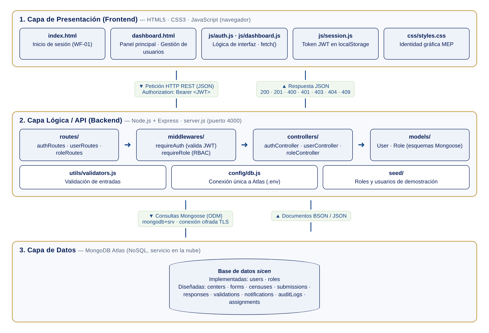
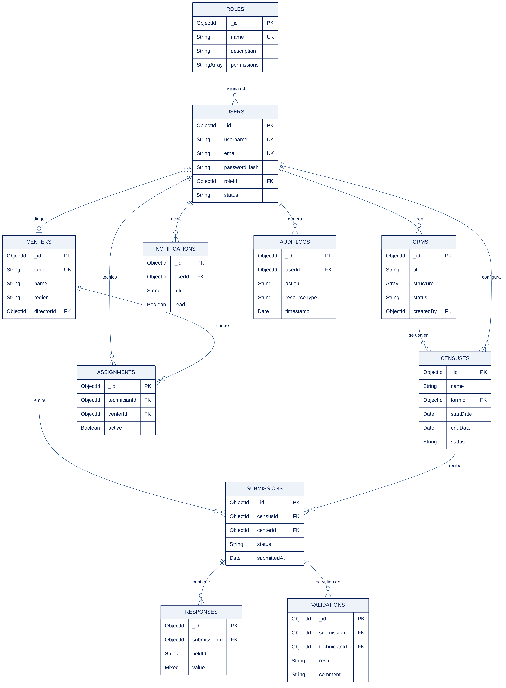
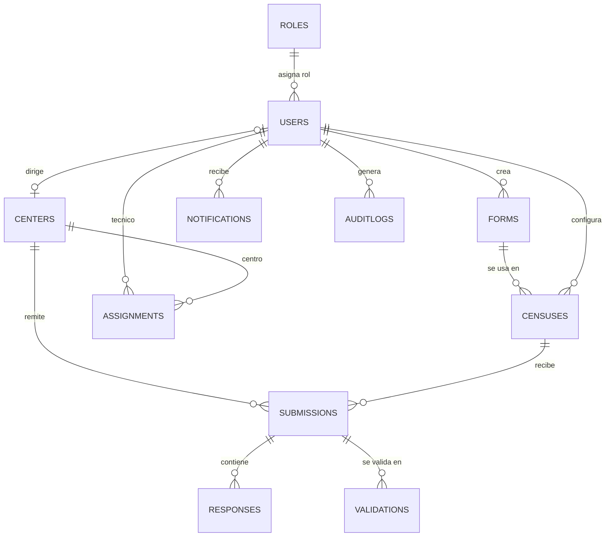

# ESPECIFICACIÓN DE DISEÑO DE SOFTWARE
## SICEN - Sistema de Gestión de Censos Escolares

**Autor:** Dylan Piña Moya
**Correo:** dpinam@ucenfotec.ac.cr
**Institución:** Universidad CENFO Técnica
**Periodo:** 2026-C3
**Fecha:** Noviembre 2026
**Versión:** 2.0
**Documento asociado a:** Bitácora 3 (versión 1.0 asociada a Bitácora 2)

---

## CONTROL DE VERSIONES

| Versión | Fecha | Cambios |
|---------|-------|---------|
| 1.0 | 29/09/2026 | Propósito y alcance, casos de uso, wireframes WF-01 a WF-09, guía de estilos, restricciones de usabilidad y navegación (Bitácora 2). |
| 2.0 | 10/11/2026 | Se agregan: arquitectura del sistema por capas y patrones (sección 5), diseño de la base de datos (sección 6), estructura de carpetas (sección 7), API REST (sección 8) y tecnologías utilizadas (sección 9). Se actualiza la guía de estilos con la identidad gráfica oficial del MEP (sección 3.2) (Bitácora 3). |

---

## 1. PROPÓSITO Y ALCANCE DEL SISTEMA

### 1.1 Propósito

Este documento define el diseño de software de SICEN: la arquitectura técnica, el diseño de la base de datos, la API REST, el modelado funcional, la interfaz de usuario y la navegación de la aplicación. Complementa la Especificación de Requisitos (`ERS_SICEN_COMPLETA.md`) y la Matriz de Trazabilidad (`MATRIZ_TRAZABILIDAD_SICEN.md`).

### 1.2 Arquitectura (resumen)

SICEN es una aplicación web cliente-servidor de tres capas (presentación, lógica/API y datos). El detalle de cada capa, cómo se comunican y los patrones empleados está en la **sección 5**.

### 1.3 Alcance

El diseño cubre los cuatro perfiles de usuario definidos en la ERS (Jefatura DAE, Técnico DAE, Director de Centro Educativo, Supervisor de Centro Educativo) y los 20 requisitos funcionales (RF-001 a RF-020), agrupados en los módulos: Autenticación, Gestión de Formularios, Gestión de Censos, Envío y Validación de Datos, Reportes, Notificaciones, Auditoría y Gestión de Usuarios.

Estado de implementación a la fecha de este documento: **implementados** RF-001 (autenticación), RF-002 (roles y permisos) y RF-019 (gestión de usuarios); los demás requisitos están **diseñados** (colecciones y endpoints definidos en las secciones 6 y 8) y se implementarán en los siguientes sprints.

Fuera de alcance en esta fase: integración con los sistemas internos del MEP, aplicación móvil nativa e internacionalización (idiomas adicionales al español).

---

## 2. MODELADO DEL SISTEMA

### 2.1 Diagrama de Casos de Uso

El diagrama de casos de uso, con los cuatro actores del sistema y sus interacciones principales, se encuentra en `diagramas/sicen_casos_uso.html`.

---

## 3. INTERFAZ DE USUARIO (UI/UX)

### 3.1 Wireframes

Se definieron 9 wireframes de baja fidelidad que cubren los flujos principales de cada rol, disponibles en `diagramas/sicen_wireframes.html`:

| Código | Pantalla | Rol principal | Requisitos |
|--------|----------|---------------|------------|
| WF-01 | Inicio de sesión | Todos | RF-001 |
| WF-02 | Formulario censal | Director de Centro | RF-010, RF-011 |
| WF-03 | Constructor de formularios | Jefatura DAE | RF-003, RF-004, RF-005 |
| WF-04 | Configuración de censo | Jefatura DAE | RF-006, RF-007, RF-008, RF-009 |
| WF-05 | Panel de validación | Técnico DAE | RF-012, RF-013, RF-014 |
| WF-06 | Gestión de usuarios | Jefatura DAE | RF-002, RF-019, RF-020 |
| WF-07 | Reportes | Jefatura DAE / Técnico DAE | RF-015, RF-016, RF-017 |
| WF-08 | Centro de notificaciones | Todos | RF-017 |
| WF-09 | Historial de auditoría | Jefatura DAE | RF-018 |

La relación completa entre cada requisito funcional y su wireframe correspondiente está documentada en `MATRIZ_TRAZABILIDAD_SICEN.md`, sección 2.

### 3.2 Guía de Estilos

En la implementación (Avance 1) la guía de estilos se alineó con el **Manual de Identidad Gráfica del MEP 2026-2030**, sustituyendo la paleta genérica de la versión 1.0:

| Uso | Color | Hex |
|-----|-------|-----|
| Primario (encabezados, barra superior) | Azul marino MEP | `#021a53` |
| Primario medio (botones, degradados) | Azul MEP | `#002e7a` |
| Secundario | Azul | `#164687` |
| Acento institucional | Dorado MEP | `#cfac65` |
| Secundario neutro | Gris MEP | `#c1c5c8` |
| Éxito / Activo | Verde | `#16a34a` |
| Error / Inactivo | Rojo | `#dc2626` |
| Fondo neutro | Gris azulado claro | `#eef1f6` |

**Tipografía:** Libre Baskerville (marca y títulos, serif institucional) e Inter (texto de interfaz). Escala: H1 28px/700, H2 19px/700, texto base 14px/400, texto auxiliar 12.5px.

**Componentes base:** barra superior institucional con logo del MEP y chip de perfil, tarjetas de módulo con insignia circular e íconos de línea, botones primario (degradado azul) y secundario (contorno), píldoras de estado ("Abrir módulo", "Sin acceso", "Próximamente"), tablas de datos, ventanas modales (nuevo colaborador, detalle de usuario).

### 3.3 Restricciones de Usabilidad y Accesibilidad

- Cumplimiento WCAG 2.1 nivel AA (contraste mínimo 4.5:1 en texto normal).
- Navegación completa por teclado, con foco visible en todos los controles interactivos (las ventanas modales se cierran con `Esc`).
- Etiquetas asociadas (`label`/`for`) en todos los campos de formulario; errores anunciados con `aria-live` para lectores de pantalla.
- Diseño responsive: soporte desde 375px (móvil) hasta 1920px (escritorio), con puntos de quiebre en 768px y 1024px.
- Textos redimensionables hasta 200% sin pérdida de contenido ni funcionalidad.
- Iconografía siempre acompañada de texto o atributo `alt`/`aria-label`.
- Estados de carga visibles ("Cargando...", "Registrando...", "Guardando...") en toda operación asíncrona.

---

## 4. DISEÑO DE NAVEGACIÓN

### 4.1 Mapa de Sitio / Flujo de Navegación

El flujo de navegación entre pantallas, organizado por tipo de usuario, está documentado en `diagramas/sicen_diagrama.html`. Desde la página de inicio de sesión (`index.html`), cada perfil accede al panel principal (`dashboard.html`), que muestra los módulos del sistema habilitados según los permisos de su rol. La sección "Gestión de usuarios" se despliega únicamente al abrir su módulo y solo para la Jefatura DAE.

---

## 5. ARQUITECTURA DEL SISTEMA

### 5.1 Diagrama de arquitectura por capas



| Capa | Responsabilidad | Componentes |
|------|-----------------|-------------|
| **1. Presentación (Frontend)** | Mostrar la interfaz, capturar datos del usuario, validar formato básico y consumir la API. No contiene reglas de negocio ni acceso directo a datos. | `index.html`, `dashboard.html`, `css/styles.css`, `js/auth.js`, `js/dashboard.js`, `js/session.js` |
| **2. Lógica / API (Backend)** | Exponer la API REST, autenticar (JWT), autorizar por rol (RBAC), validar entradas y aplicar las reglas de negocio. | `server.js`, `routes/`, `middlewares/`, `controllers/`, `models/`, `utils/`, `config/` |
| **3. Datos** | Persistir los documentos del sistema de forma segura y disponible. | MongoDB Atlas, base de datos `sicen` |

### 5.2 Comunicación entre capas

| Origen → Destino | Protocolo / formato | Detalle |
|------------------|---------------------|---------|
| Presentación → API | HTTP REST, cuerpo JSON (`Content-Type: application/json`) | Peticiones con `fetch()`. Las rutas protegidas envían el encabezado `Authorization: Bearer <token>`. La URL base se configura en `js/session.js` (`SICEN_API_BASE_URL`, por defecto `http://localhost:4000/api`). CORS habilitado en el backend. |
| API → Presentación | JSON + códigos HTTP | `200` OK, `201` creado, `400` datos inválidos, `401` no autenticado / token inválido, `403` rol sin permiso, `404` no encontrado, `409` duplicado (correo o usuario). Ante un `401`, el frontend borra la sesión y redirige al inicio de sesión. |
| API → Datos | Mongoose (ODM) sobre el driver oficial de MongoDB, cadena `mongodb+srv` con TLS | Una única conexión al iniciar el servidor (`config/db.js`), con la cadena tomada de la variable de entorno `MONGODB_URI`. |

**Flujo de una petición protegida (ejemplo: crear colaborador):**

1. `dashboard.js` envía `POST /api/users` con el token JWT y los datos del formulario.
2. `routes/userRoutes.js` dirige la petición por la cadena de middlewares.
3. `requireAuth` verifica la firma y vigencia del token y adjunta el usuario a `req.user`.
4. `requireRole('Jefatura DAE')` comprueba el rol; si no coincide responde `403`.
5. `userController.createUser` valida los datos (`utils/validators.js`), verifica que el rol exista y que no haya duplicados, cifra la contraseña con bcrypt y guarda el documento con el modelo `User`.
6. MongoDB Atlas persiste el documento y la API responde `201` con el colaborador creado; el frontend recarga la tabla.

### 5.3 Patrones arquitectónicos empleados

| Patrón | Dónde se aplica | Justificación |
|--------|-----------------|---------------|
| **Arquitectura en capas (cliente-servidor de 3 capas)** | Separación Frontend / API / Base de datos | Aísla la interfaz de las reglas de negocio y de los datos: cada capa puede cambiar o escalar por separado (por ejemplo, otra interfaz podría consumir la misma API) y facilita el trabajo y las pruebas por partes. |
| **MVC adaptado a API REST (Route – Controller – Model)** | `routes/` → `controllers/` → `models/`; la "vista" es el frontend estático que consume JSON | Ordena el backend por responsabilidad: las rutas solo definen endpoints, los controladores contienen la lógica y los modelos el esquema de datos. Es la organización estándar en Express y simplifica ubicar el código de cada requisito. |
| **API REST (recursos + verbos HTTP)** | Toda la comunicación frontend–backend | Interfaz uniforme y sin estado (`GET` consulta, `POST` crea, `PATCH`/`PUT` modifica, `DELETE` elimina), fácil de documentar y de probar, y alineada con el stack del curso. |
| **Cadena de middlewares (Chain of Responsibility)** | `requireAuth` → `requireRole` antes de cada controlador protegido | Centraliza la seguridad: cada eslabón valida una condición y corta la cadena si falla, sin repetir código de autenticación/autorización en cada controlador. |
| **Control de acceso basado en roles (RBAC)** | Colección `roles` con lista de permisos; middleware `requireRole`; grid de módulos del frontend según `permissions` | Requisito RF-002: los cuatro perfiles del MEP tienen responsabilidades distintas; asociar permisos al rol (no al usuario) simplifica la administración y la auditoría. |
| **Autenticación sin estado con token (JWT)** | `POST /api/auth/login` emite el token; `requireAuth` lo valida | El servidor no guarda sesiones en memoria: cada petición se autentica por sí misma, lo que facilita escalar el backend. El token expira (8 h por defecto). |
| **ODM / Active Record (Mongoose)** | `models/User.js`, `models/Role.js` | Da esquema, tipos, campos obligatorios/únicos y validación a una base NoSQL que no los impone por sí sola, y encapsula las operaciones CRUD de cada colección. |
| **Configuración externa (variables de entorno)** | `.env` / `.env.example`, `config/db.js` | Las credenciales (cadena de Atlas, secreto JWT) no se suben al repositorio y pueden cambiar entre entornos sin tocar el código. |

---

## 6. DISEÑO DE LA BASE DE DATOS (MongoDB Atlas)

### 6.1 Diagrama de colecciones





Al ser MongoDB una base de datos documental, las relaciones se modelan **por referencia** (`ObjectId`) y no con llaves foráneas; la obligatoriedad, unicidad y validaciones se implementan con los esquemas de Mongoose y con validaciones en los controladores. Todas las colecciones incluyen `_id` (ObjectId, generado automáticamente, único).

**Estado:** `users` y `roles` están **implementadas** (`backend/models/`). Las demás colecciones están **diseñadas** para los siguientes sprints. Se agregó la colección `centers` (centros educativos), necesaria para modelar los envíos por centro (RF-010/011) y la asignación de técnicos (RF-020).

### 6.2 Diccionario de datos por colección

#### `roles` — Implementada (RF-002)

| Campo | Tipo | Obligatorio | Único | Reglas de validación |
|-------|------|:-----------:|:-----:|----------------------|
| `name` | String | Sí | Sí | Se recortan espacios (`trim`). Valores definidos por la semilla: Jefatura DAE, Técnico DAE, Director de Centro Educativo, Supervisor de Centro Educativo. |
| `description` | String | No | No | `trim`. |
| `permissions` | [String] | No | No | Por defecto `[]`. Formato `recurso:acción` (ej. `users:manage`, `forms:fill`). |
| `createdAt` | Date | Auto | No | Generado por `timestamps`. |

#### `users` — Implementada (RF-001, RF-019)

| Campo | Tipo | Obligatorio | Único | Reglas de validación |
|-------|------|:-----------:|:-----:|----------------------|
| `username` | String | Sí | Sí | `trim`; mínimo 3 caracteres. |
| `email` | String | Sí | Sí | `trim` y minúsculas; formato de correo válido (`texto@dominio.ext`). |
| `passwordHash` | String | Sí | No | Contraseña de mínimo 8 caracteres, guardada solo como hash bcrypt (10 rondas). Nunca se devuelve en las respuestas. |
| `roleId` | ObjectId → `roles` | Sí | No | El rol debe existir; solo la Jefatura DAE puede asignar roles distintos al de Director de Centro. |
| `status` | String | Sí (por defecto) | No | Enumeración `active` / `inactive`; por defecto `active`. Un usuario `inactive` no puede iniciar sesión. Nadie puede cambiar el estado de su propia cuenta. |
| `createdAt` / `updatedAt` | Date | Auto | No | Generados por `timestamps` ("fecha de alta" en la interfaz). |

#### `centers` — Diseñada (RF-010, RF-011, RF-020)

| Campo | Tipo | Obligatorio | Único | Reglas de validación |
|-------|------|:-----------:|:-----:|----------------------|
| `code` | String | Sí | Sí | Código oficial del centro educativo del MEP. |
| `name` | String | Sí | No | Mínimo 3 caracteres. |
| `region` | String | Sí | No | Dirección Regional de Educación. |
| `circuit` | String | No | No | Circuito escolar. |
| `directorId` | ObjectId → `users` | No | Sí (si existe) | El usuario debe tener rol Director de Centro Educativo. |
| `status` | String | Sí | No | `active` / `inactive`; por defecto `active`. |

#### `forms` — Diseñada (RF-003, RF-004, RF-005)

| Campo | Tipo | Obligatorio | Único | Reglas de validación |
|-------|------|:-----------:|:-----:|----------------------|
| `title` | String | Sí | No | Mínimo 3 caracteres. |
| `description` | String | No | No | Máximo 500 caracteres. |
| `structure` | [Object] | Sí | No | Al menos un campo. Cada campo: `fieldId` (único dentro del formulario), `label`, `type` (`text` / `number` / `select` / `date` / `boolean`), `required` (Boolean), `options` (obligatorio si `type = select`). |
| `status` | String | Sí | No | `draft` / `published` / `archived`; por defecto `draft`. |
| `isDeleted` | Boolean | Sí | No | Borrado lógico (RF-005); por defecto `false`. No se puede eliminar un formulario usado por un censo abierto. |
| `createdBy` | ObjectId → `users` | Sí | No | Usuario con rol Jefatura DAE. |
| `createdAt` / `updatedAt` | Date | Auto | No | `timestamps`. |

#### `censuses` — Diseñada (RF-006 a RF-009)

| Campo | Tipo | Obligatorio | Único | Reglas de validación |
|-------|------|:-----------:|:-----:|----------------------|
| `name` | String | Sí | No | Mínimo 3 caracteres. |
| `year` | Number | Sí | No | Año de 4 dígitos. |
| `formId` | ObjectId → `forms` | Sí | No | El formulario debe estar `published`. |
| `startDate` | Date | Sí | No | — |
| `endDate` | Date | Sí | No | Debe ser posterior a `startDate`. |
| `status` | String | Sí | No | `CONFIGURED` → `OPEN` ⇄ `PAUSED` → `CLOSED`; por defecto `CONFIGURED`. Un censo `CLOSED` no cambia de estado. |
| `createdBy` | ObjectId → `users` | Sí | No | Jefatura DAE. |

#### `submissions` — Diseñada (RF-010, RF-011, RF-013, RF-014)

| Campo | Tipo | Obligatorio | Único | Reglas de validación |
|-------|------|:-----------:|:-----:|----------------------|
| `censusId` | ObjectId → `censuses` | Sí | Sí (compuesto con `centerId`) | Un solo envío por centro y censo. |
| `centerId` | ObjectId → `centers` | Sí | Sí (compuesto) | — |
| `status` | String | Sí | No | `draft` / `submitted` / `accepted` / `returned`; por defecto `draft`. Solo se puede enviar si el censo está `OPEN` y todos los campos obligatorios tienen respuesta. |
| `submittedBy` | ObjectId → `users` | No | No | Director del centro. |
| `submittedAt` / `validatedAt` | Date | No | No | Se registran al enviar y al validar. |

#### `responses` — Diseñada (RF-010, RF-012)

| Campo | Tipo | Obligatorio | Único | Reglas de validación |
|-------|------|:-----------:|:-----:|----------------------|
| `submissionId` | ObjectId → `submissions` | Sí | Sí (compuesto con `fieldId`) | — |
| `fieldId` | String | Sí | Sí (compuesto) | Debe existir en la `structure` del formulario del censo. |
| `value` | Mixed | Según campo | No | El tipo debe coincidir con el `type` del campo. |

#### `validations` — Diseñada (RF-012, RF-013, RF-014)

| Campo | Tipo | Obligatorio | Único | Reglas de validación |
|-------|------|:-----------:|:-----:|----------------------|
| `submissionId` | ObjectId → `submissions` | Sí | No | El envío debe estar `submitted`. |
| `technicianId` | ObjectId → `users` | Sí | No | Técnico DAE asignado al centro. |
| `result` | String | Sí | No | `accepted` / `returned`. |
| `comment` | String | Condicional | No | Obligatorio si `result = returned` (RF-014). |
| `checks` | [Object] | No | No | Resultado de reglas automáticas: `rule`, `passed`, `message`. |
| `createdAt` | Date | Auto | No | `timestamps`. |

#### `notifications` — Diseñada (RF-017)

| Campo | Tipo | Obligatorio | Único | Reglas de validación |
|-------|------|:-----------:|:-----:|----------------------|
| `userId` | ObjectId → `users` | Sí | No | Destinatario. |
| `title` | String | Sí | No | Máximo 120 caracteres. |
| `message` | String | Sí | No | — |
| `type` | String | Sí | No | `info` / `alert` / `reminder`. |
| `read` | Boolean | Sí | No | Por defecto `false`. |
| `createdAt` | Date | Auto | No | `timestamps`. |

#### `auditLogs` — Diseñada (RF-018)

| Campo | Tipo | Obligatorio | Único | Reglas de validación |
|-------|------|:-----------:|:-----:|----------------------|
| `userId` | ObjectId → `users` | Sí | No | Usuario que ejecuta la acción. |
| `action` | String | Sí | No | `LOGIN`, `CREATE`, `UPDATE`, `DELETE`, `STATUS_CHANGE`. |
| `resourceType` | String | Sí | No | Colección afectada (`users`, `forms`, `censuses`, ...). |
| `resourceId` | ObjectId | No | No | Documento afectado. |
| `changes` | Mixed | No | No | Valores anteriores y nuevos. |
| `ip` | String | No | No | Dirección IP de origen. |
| `timestamp` | Date | Sí | No | Por defecto la fecha actual. Los registros son de solo inserción (no se editan ni eliminan). |

#### `assignments` — Diseñada (RF-020)

| Campo | Tipo | Obligatorio | Único | Reglas de validación |
|-------|------|:-----------:|:-----:|----------------------|
| `technicianId` | ObjectId → `users` | Sí | No | El usuario debe tener rol Técnico DAE y estar `active`. |
| `centerId` | ObjectId → `centers` | Sí | Sí entre asignaciones activas | Un centro tiene como máximo un técnico activo. |
| `assignedAt` | Date | Sí | No | Por defecto la fecha actual. |
| `active` | Boolean | Sí | No | Por defecto `true`; al reasignar se desactiva la anterior. |

### 6.3 Relaciones y cardinalidad

| Relación | Cardinalidad | Implementación (referencia) | Descripción |
|----------|:------------:|-----------------------------|-------------|
| `roles` — `users` | 1 : N | `users.roleId` | Un rol se asigna a muchos usuarios; cada usuario tiene exactamente un rol. |
| `users` — `centers` | 1 : 0..1 | `centers.directorId` | Un director dirige a lo sumo un centro; un centro tiene a lo sumo un director registrado. |
| `users` — `forms` | 1 : N | `forms.createdBy` | La Jefatura DAE crea muchos formularios. |
| `forms` — `censuses` | 1 : N | `censuses.formId` | Un formulario puede reutilizarse en varios censos (por ejemplo, de distintos años). |
| `users` — `censuses` | 1 : N | `censuses.createdBy` | La Jefatura DAE configura muchos censos. |
| `censuses` — `submissions` | 1 : N | `submissions.censusId` | Un censo recibe un envío por cada centro. |
| `centers` — `submissions` | 1 : N | `submissions.centerId` | Un centro remite un envío por censo (único compuesto `censusId + centerId`). |
| `submissions` — `responses` | 1 : N | `responses.submissionId` | Un envío contiene una respuesta por campo del formulario. |
| `submissions` — `validations` | 1 : N | `validations.submissionId` | Un envío puede validarse varias veces (por ejemplo, tras ser devuelto y reenviado). |
| `users` — `validations` | 1 : N | `validations.technicianId` | Un técnico registra muchas validaciones. |
| `users` — `notifications` | 1 : N | `notifications.userId` | Un usuario recibe muchas notificaciones. |
| `users` — `auditLogs` | 1 : N | `auditLogs.userId` | Cada acción auditada pertenece a un usuario. |
| `users` (Técnico) — `centers` | N : M | Colección intermedia `assignments` | Un técnico atiende varios centros y, en el tiempo, un centro puede tener varios técnicos (uno activo a la vez). |

---

## 7. ESTRUCTURA DEL SISTEMA (CARPETAS)

```
SICEN/
├── backend/                     API REST (Node.js + Express)
│   ├── config/
│   │   └── db.js                Conexión única a MongoDB Atlas con Mongoose
│   ├── controllers/             Lógica de cada recurso (casos de uso)
│   │   ├── authController.js    Registro e inicio de sesión (JWT)
│   │   ├── userController.js    Perfil, listado, alta y cambio de estado de usuarios
│   │   └── roleController.js    Listado de roles
│   ├── middlewares/             Filtros previos a los controladores
│   │   ├── authMiddleware.js    requireAuth: valida el token JWT
│   │   └── roleMiddleware.js    requireRole: autorización por rol (RBAC)
│   ├── models/                  Esquemas Mongoose (colecciones)
│   │   ├── User.js
│   │   └── Role.js
│   ├── routes/                  Definición de endpoints por recurso
│   │   ├── authRoutes.js        /api/auth
│   │   ├── userRoutes.js        /api/users
│   │   └── roleRoutes.js        /api/roles
│   ├── seed/                    Datos iniciales
│   │   ├── roleDefinitions.js   Definición única de los 4 roles y sus permisos
│   │   ├── seedRoles.js         Carga los roles base
│   │   └── seedUsers.js         Carga un usuario de demostración por rol
│   ├── utils/
│   │   └── validators.js        Validación de correo y textos
│   ├── .env.example             Plantilla de variables de entorno (sin credenciales)
│   ├── package.json             Dependencias y scripts (start, dev, seed:*)
│   └── server.js                Punto de entrada: middlewares globales, rutas y arranque
├── frontend/                    Interfaz web estática (HTML/CSS/JS)
│   ├── css/
│   │   └── styles.css           Estilos con la identidad gráfica del MEP
│   ├── img/                     Logos oficiales del MEP y favicons
│   ├── js/
│   │   ├── session.js           URL de la API y manejo del token en localStorage
│   │   ├── auth.js              Lógica del inicio de sesión
│   │   └── dashboard.js         Panel principal, módulos por rol y gestión de usuarios
│   ├── index.html               Pantalla de inicio de sesión (WF-01)
│   └── dashboard.html           Panel principal (WF-06 Gestión de usuarios)
├── diagramas/                   Casos de uso, navegación, wireframes, arquitectura y colecciones
├── docs/                        Documentos en formato Word (bitácora)
├── ERS_SICEN_COMPLETA.md        Especificación de requisitos
├── ESPECIFICACION_DISENO_SICEN.md  Este documento
├── MATRIZ_TRAZABILIDAD_SICEN.md Trazabilidad requisito → historia → componente → endpoint
├── BITACORA_SICEN.md            Bitácora del proyecto
└── README.md                    Instalación y ejecución
```

Para los módulos siguientes se mantendrá la misma convención: por cada recurso nuevo se agregará un modelo en `models/`, un controlador en `controllers/` y su archivo de rutas en `routes/` (por ejemplo `Form.js` / `formController.js` / `formRoutes.js`), y en el frontend una página HTML con su script en `js/`.

---

## 8. API REST

**URL base:** `http://localhost:4000/api` (local). Todas las peticiones y respuestas usan JSON. Acceso: **Público** (sin token), **Autenticado** (token JWT válido) o un rol específico (token + `requireRole`).

### 8.1 Endpoints implementados

| Requerimiento | Método | Ruta | Descripción | Acceso |
|---------------|--------|------|-------------|--------|
| RF-001 | POST | `/api/auth/login` | Autentica con correo y contraseña. Devuelve un token JWT (vigencia 8 h) y los datos básicos del usuario. Usuarios inactivos o credenciales incorrectas reciben `401`. | Público |
| RF-001 | POST | `/api/auth/register` | Registro público de un usuario. Siempre asigna el rol Director de Centro Educativo. Valida usuario (≥3), correo y contraseña (≥8); `409` si el correo o usuario ya existe. | Público |
| RF-001, RF-002 | GET | `/api/users/me` | Devuelve el perfil del usuario autenticado con su rol y la lista de permisos del rol (usada por el frontend para habilitar módulos). | Autenticado |
| RF-019 | GET | `/api/users` | Lista todos los usuarios (usuario, correo, rol, estado, fecha de alta), del más reciente al más antiguo. | Jefatura DAE |
| RF-019, RF-002 | POST | `/api/users` | Registra un colaborador y le asigna un rol existente. `400` si faltan datos o el rol no existe; `409` si está duplicado. | Jefatura DAE |
| RF-019 | PATCH | `/api/users/:id/status` | Activa o desactiva la cuenta de un colaborador (`active` / `inactive`). No permite cambiar la propia cuenta. | Jefatura DAE |
| RF-002 | GET | `/api/roles` | Lista los roles del sistema (nombre y descripción) para asignarlos al crear colaboradores. | Jefatura DAE |
| — (soporte) | GET | `/api/health` | Verificación del estado del servicio (monitoreo). | Público |

### 8.2 Endpoints diseñados (siguientes sprints)

| Requerimiento | Método | Ruta | Descripción | Acceso |
|---------------|--------|------|-------------|--------|
| RF-002 | PATCH | `/api/users/:id/role` | Cambia el rol de un usuario. | Jefatura DAE |
| RF-019 | PUT | `/api/users/:id` | Edita los datos de un colaborador (usuario, correo). | Jefatura DAE |
| RF-003 | POST | `/api/forms` | Crea un formulario censal con su estructura de campos. | Jefatura DAE |
| RF-003, RF-004 | GET | `/api/forms` | Lista los formularios no eliminados (filtro por estado). | Jefatura DAE |
| RF-003, RF-004 | GET | `/api/forms/:id` | Obtiene un formulario con su estructura. | Jefatura DAE |
| RF-004 | PUT | `/api/forms/:id` | Modifica título, descripción o campos de un formulario. | Jefatura DAE |
| RF-005 | DELETE | `/api/forms/:id` | Elimina un formulario (borrado lógico, `isDeleted = true`). | Jefatura DAE |
| RF-006 | POST | `/api/censuses` | Crea y configura un censo (formulario, año, fechas). | Jefatura DAE |
| RF-006 | PUT | `/api/censuses/:id` | Modifica la configuración de un censo aún no abierto. | Jefatura DAE |
| RF-006 | GET | `/api/censuses` | Lista los censos y su estado. | Autenticado |
| RF-007 | PATCH | `/api/censuses/:id/open` | Abre el censo para recibir formularios. | Jefatura DAE |
| RF-008 | PATCH | `/api/censuses/:id/pause` | Pausa temporalmente el censo. | Jefatura DAE |
| RF-009 | PATCH | `/api/censuses/:id/close` | Cierra definitivamente el periodo de recolección. | Jefatura DAE |
| RF-010 | GET | `/api/censuses/:id/form` | Obtiene el formulario del censo abierto para el centro del director. | Director de Centro |
| RF-010 | PUT | `/api/submissions/:id/responses` | Guarda (borrador) las respuestas del formulario. | Director de Centro |
| RF-011 | POST | `/api/submissions/:id/submit` | Envía el formulario completo para validación. | Director de Centro |
| RF-012 | GET | `/api/submissions?status=submitted` | Bandeja de formularios recibidos de los centros asignados al técnico. | Técnico DAE |
| RF-012 | POST | `/api/submissions/:id/validations` | Ejecuta las reglas de validación y registra el resultado. | Técnico DAE |
| RF-013 | PATCH | `/api/submissions/:id/accept` | Acepta el formulario validado. | Técnico DAE |
| RF-014 | PATCH | `/api/submissions/:id/return` | Devuelve el formulario al centro con comentarios obligatorios. | Técnico DAE |
| RF-015 | GET | `/api/reports?censusId=&region=` | Genera un reporte consolidado con filtros. | Jefatura DAE, Técnico DAE |
| RF-016 | GET | `/api/reports/export?censusId=&format=pdf\|xlsx` | Descarga el reporte en PDF o Excel. | Jefatura DAE, Técnico DAE |
| RF-017 | GET | `/api/notifications` | Lista las notificaciones del usuario autenticado. | Autenticado |
| RF-017 | PATCH | `/api/notifications/:id/read` | Marca una notificación como leída. | Autenticado |
| RF-017 | POST | `/api/notifications` | Envía un comunicado a uno o varios usuarios. | Jefatura DAE, Técnico DAE |
| RF-018 | GET | `/api/audit-logs?userId=&action=&from=&to=` | Consulta el historial auditable con filtros. | Jefatura DAE |
| RF-020 | GET | `/api/centers` | Lista los centros educativos (apoyo a la asignación). | Jefatura DAE |
| RF-020 | POST | `/api/assignments` | Asigna un técnico a un centro educativo. | Jefatura DAE |
| RF-020 | GET | `/api/assignments` | Lista las asignaciones activas. | Jefatura DAE |
| RF-020 | DELETE | `/api/assignments/:id` | Finaliza una asignación (`active = false`). | Jefatura DAE |

---

## 9. TECNOLOGÍAS UTILIZADAS

| Tecnología | Versión | Tipo | Propósito |
|------------|---------|------|-----------|
| Node.js | 18 LTS o superior | Entorno de ejecución | Ejecutar el backend en JavaScript del lado del servidor. |
| Express | 4.22.3 | Framework web | Definir la API REST, rutas y cadena de middlewares. |
| MongoDB Atlas | Servicio gestionado (driver `mongodb` 6.20.0) | Base de datos NoSQL en la nube | Persistencia de documentos con alta disponibilidad y respaldo. |
| Mongoose | 8.24.7 | ODM | Esquemas, tipos, validaciones y consultas sobre MongoDB. |
| jsonwebtoken | 9.0.3 | Biblioteca | Firmar y verificar los tokens JWT de sesión. |
| bcryptjs | 2.4.3 | Biblioteca | Cifrar (hash) y comparar contraseñas. |
| cors | 2.8.6 | Middleware | Permitir que el frontend consuma la API desde otro origen. |
| dotenv | 16.6.1 | Biblioteca | Cargar variables de entorno desde `.env`. |
| nodemon | 3.1.14 | Herramienta de desarrollo | Reiniciar el servidor automáticamente al guardar cambios (`npm run dev`). |
| npm | Incluido con Node.js | Gestor de paquetes | Instalar dependencias y ejecutar scripts (`start`, `seed:demo`). |
| HTML5 | Estándar W3C | Lenguaje de marcado | Estructura de las páginas (`index.html`, `dashboard.html`). |
| CSS3 | Estándar W3C | Hojas de estilo | Diseño visual, variables de color MEP, diseño responsive. |
| JavaScript | ECMAScript 2020 (vanilla, sin framework) | Lenguaje del cliente | Interactividad, `fetch()` a la API y manejo de sesión. |
| Fetch API / localStorage | Nativas del navegador | APIs web | Comunicación asíncrona con el servidor y almacenamiento del token. |
| Google Fonts (Libre Baskerville, Inter) | Servicio web | Tipografía | Tipografías alineadas a la identidad gráfica institucional. |
| Git / GitHub | Git 2.x | Control de versiones | Historial de cambios y repositorio del proyecto (`main`, `avance-1`). |
| Jira Software Cloud | Servicio web | Gestión de proyecto | Épicas, historias de usuario y sprints (Scrum). |
| Visual Studio Code | Versión estable | Editor | Desarrollo del código. |

---

## 10. ACTUALIZACIONES RELACIONADAS (BITÁCORA 3)

- **Matriz de trazabilidad** (`MATRIZ_TRAZABILIDAD_SICEN.md`, v2.0): se agregó la sección "Trazabilidad requisito → endpoint", se actualizaron los componentes reales de los requisitos implementados y el estado de cada requisito (implementado / diseñado), y se alineó el modelo de colecciones con la sección 6 de este documento.
- **Seguridad:** el endpoint público `POST /api/auth/register` aceptaba el campo `roleName`, lo que permitía auto-registrarse con un rol administrativo. Se corrigió para asignar siempre el rol de menor privilegio (ver Bitácora 3, inconvenientes).
- **README:** se actualizó la tabla de endpoints disponibles.
- **Proyecto en Jira:** se registraron las actividades de esta fase (ver Bitácora 3 para el enlace y evidencia).

---

**Documento actualizado:** 10 de noviembre de 2026
**Estado:** Completo
